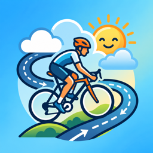
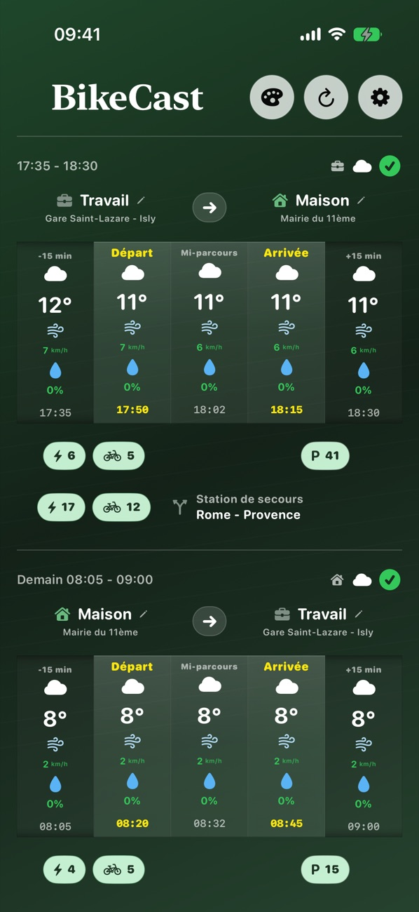
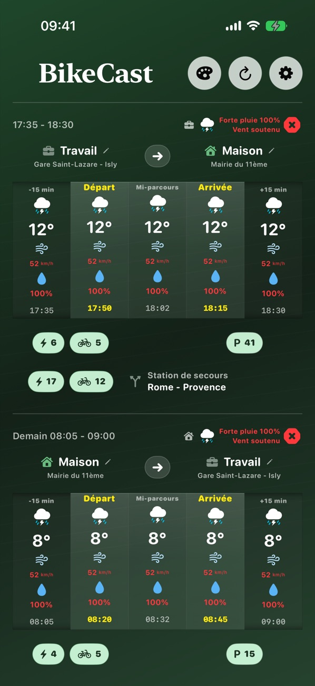
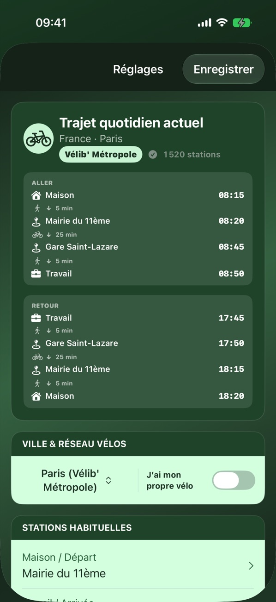
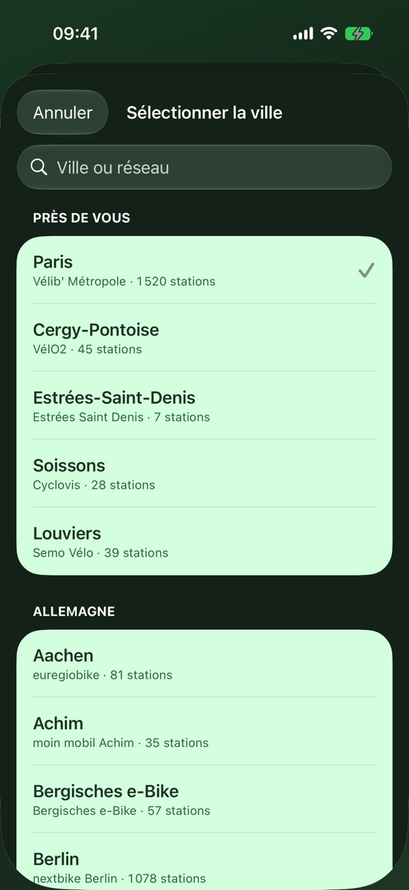
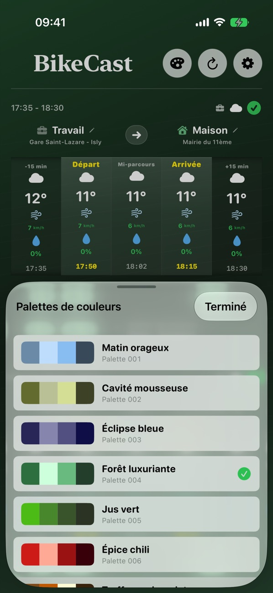

<h1>Sachez avant de pédaler.</h1>

BikeCast affiche la météo de votre trajet exact et, en temps réel, les vélos et places disponibles à vos stations, le tout sur un seul écran.

Bientôt sur l'App Store · iOS 17 ou version ultérieure

<figure markdown>

<figcaption>Vos deux prochains trajets</figcaption>
</figure>
<figure markdown>

<figcaption>Des alertes claires (météo simulée)</figcaption>
</figure>
<figure markdown>

<figcaption>Choisissez vos stations sur la carte</figcaption>
</figure>
<figure markdown>

<figcaption>Tout votre trajet, de porte à porte</figcaption>
</figure>
<figure markdown>

<figcaption>318 réseaux dans 38 pays</figcaption>
</figure>
<figure markdown>

<figcaption>100 palettes de couleurs</figcaption>
</figure>

## Votre trajet, pas toute la journée

La plupart des apps météo parlent de la journée entière. Vous n'avez besoin que des minutes passées en selle. Réglez une fois vos stations et vos horaires, BikeCast s'occupe du reste.

- Votre prochain trajet s'affiche en haut et le suivant juste en dessous, sans rien avoir à changer
- Des prévisions au départ, à mi-parcours et à l'arrivée, calées sur votre trajet
- Température, conditions, vent et pluie en un coup d'œil
- Un battement facultatif ajoute des prévisions juste avant le départ et juste après l'arrivée

## La météo là où vous roulez

Avec un réseau de vélos en libre-service, les prévisions suivent votre parcours : station de départ, milieu du trajet et station d'arrivée. Avec votre propre vélo, elles utilisent votre position actuelle.

## Vos stations en temps réel

Voyez les vélos électriques et mécaniques à la station de départ, les places libres à la station d'arrivée et une station de secours à proximité. Ouvrez la carte pour comparer les stations voisines, et changez de station en quelques touchers.

## Partir ou attendre

Chaque trajet reçoit un voyant vert, orange ou rouge, avec les raisons juste à côté : pluie, vent fort, peu de vélos, aucune place libre.

## Un widget pour votre écran d'accueil

Ajoutez le petit widget et choisissez ce qu'il affiche : les disponibilités des stations ou la météo du trajet. Il suit votre prochain trajet, reprend vos couleurs et conserve les dernières données hors ligne.

## Simple et respectueux

Aucun compte à créer. Votre profil de trajet est enregistré sur votre iPhone. [Voir comment vos données sont utilisées](support.md#vos-donnees-et-votre-position).

---

Besoin d'aide ? Rendez-vous sur la [page d'assistance](support.md).

*BikeCast est indépendante et n'est pas affiliée aux réseaux de vélos répertoriés. Les nombres de vélos et de places indiquent la disponibilité actuelle publiée par chaque réseau. Ils ne prédisent pas ce qui sera disponible au moment de votre départ.*
