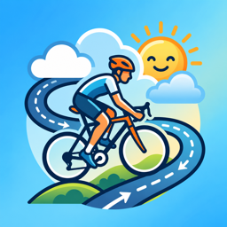
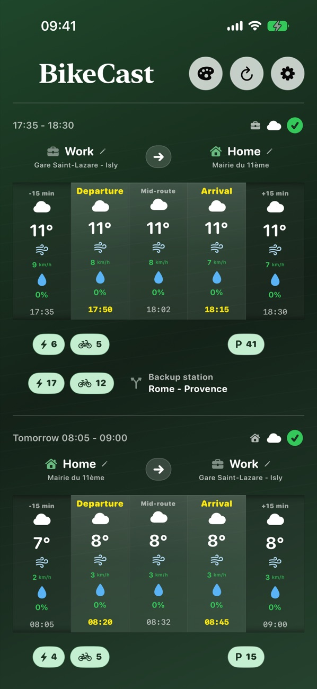
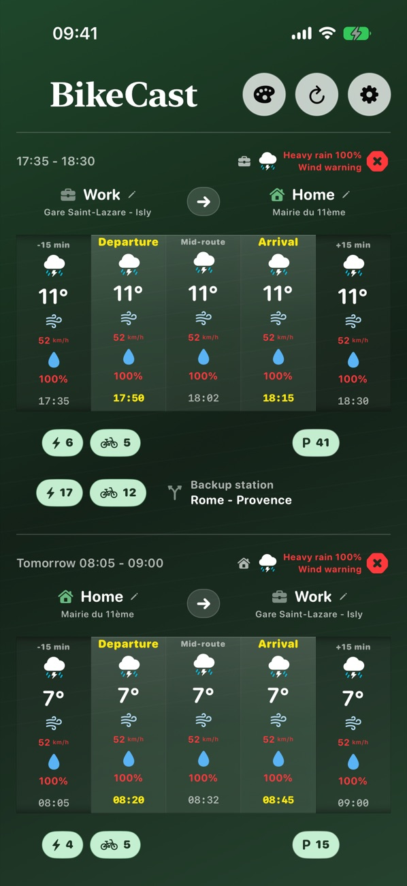
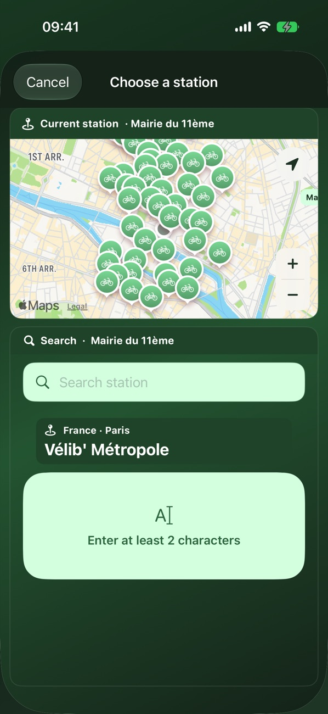
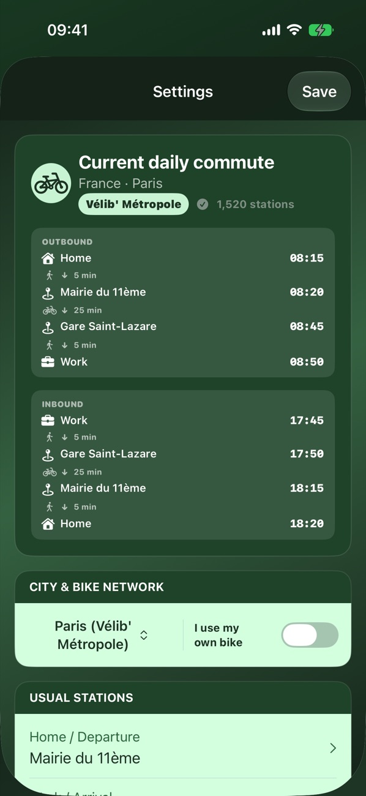
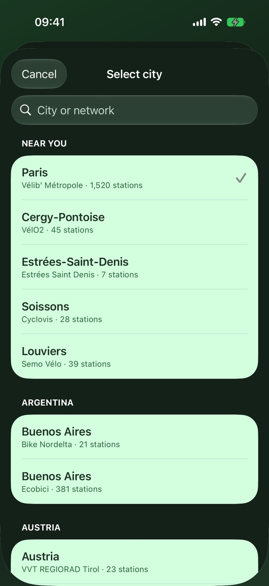
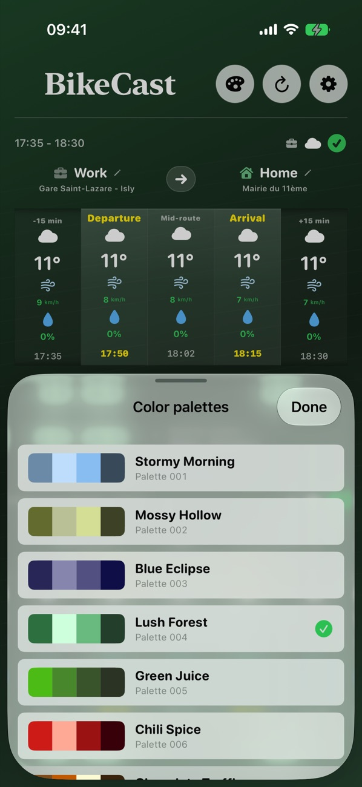

<h1>Know before you ride.</h1>

BikeCast shows the weather for your exact commute and the live availability of bikes and docks at your stations, all on one screen.

Coming soon to the App Store · iOS 17 or later

<figure markdown>

<figcaption>Your next two trips</figcaption>
</figure>
<figure markdown>

<figcaption>Clear alerts (simulated weather)</figcaption>
</figure>
<figure markdown>

<figcaption>Pick your stations on a map</figcaption>
</figure>
<figure markdown>

<figcaption>Your whole commute, door to door</figcaption>
</figure>
<figure markdown>

<figcaption>318 networks in 38 countries</figcaption>
</figure>
<figure markdown>

<figcaption>100 color palettes</figcaption>
</figure>

## Your commute, not the whole day

Most weather apps tell you about the whole day. You only need the minutes you'll spend on the saddle. Set your stations and departure times once, and BikeCast does the rest.

- Your next trip appears at the top and the following one just below, with no switching
- Departure, midway and arrival forecasts, timed to your ride
- Temperature, conditions, wind and rain at a glance
- Optional padding adds forecasts just before you leave and just after you arrive

## Weather where you actually ride

With a bike-share network, forecasts follow your route: your departure station, the midpoint and your arrival station. With your own bike, they use your current location.

## Live station status

See the e-bikes and classic bikes at your departure station, the free docks at your arrival station and a nearby backup station. Open the map to compare nearby stations, and change a station in a couple of taps.

## Go or no-go

Each trip gets a green, orange or red signal, with the reasons right beside it: rain, strong wind, few bikes, no free docks.

## A widget for your Home Screen

Add the small widget and choose what it shows: station availability or your commute forecast. It follows your next trip, uses your colors and keeps the latest data on screen when you're offline.

## Simple and private

No account to create. Your commute profile is stored on your iPhone. [Read how your data is used](support.md#your-data-and-location).

---

Need help? Visit the [support page](support.md).

*BikeCast is independent and isn't affiliated with the bike-share networks it lists. Bike and dock numbers show availability right now, as published by each network, and don't predict what will be available when you leave.*
